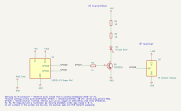

# Reference build: schematic

The circuit of a working build of this component: an ESP32-C3 Super Mini driving a 5 mm IR LED
through an NPN transistor, plus an IR receiver module for state read-back. It was traced and
measured from the breadboard prototype (2026-11-21).



| File | What |
|---|---|
| `samsung_ac_ir.kicad_pro` / `.kicad_sch` | **The schematic (master copy)**, KiCad 10. Edit this. |
| `samsung_ac_ir.kicad_sym`, `sym-lib-table` | Project symbols: ESP32-C3 Super Mini (used pins only), IR receiver module |
| `samsung_ac_ir.svg` | Exported drawing, cropped to the circuit (generated by `export_svg.py`, committed so GitHub can show it) |
| `wiring.yml` → `wiring.svg` | Point-to-point harness for a build without a board ([WireViz](https://github.com/wireviz/WireViz)). Kept in step with the schematic by hand. The SVG is generated and committed so GitHub can show it. |
| `export_svg.py` | Runs `kicad-cli sch export svg` and crops the result to the drawn circuit |
| `check_netlist.py` | Exports the netlist with `kicad-cli` and checks it against the traced nets below (exit 0 = match) |

After editing, regenerate the SVGs and re-run the check:

```sh
python3 export_svg.py
wireviz wiring.yml                                      # also writes wiring.png / .bom.tsv / .html (git-ignored)
python3 check_netlist.py
# optional PDF (git-ignored): kicad-cli sch export pdf -o samsung_ac_ir.pdf samsung_ac_ir.kicad_sch
```

## Circuit

```
 ESP 5V ── R1 10Ω ── R2 10Ω ── LED A (long leg) ┐
                                                 LED K (short leg) ── Q1 C
 ESP 21 ── R3 1kΩ ─────────────────────────────────────────────────── Q1 B     Q1 = 2N2222A (TO-92)
 ESP G  ─┬─────────────────────────────────────────────────────────── Q1 E
         └── receiver GND
 ESP 3.3 ─── receiver VCC
 ESP 20  ─── receiver OUT
```

| Net | Connects |
|---|---|
| +5V | ESP 5V, R1 |
| — | R1, R2: 10 Ω + 10 Ω in series = 20 Ω |
| — | R2, LED anode (long leg) |
| — | LED cathode (short leg), Q1 collector |
| — | Q1 base, R3 (1 kΩ) |
| GPIO21 | R3, ESP 21 (`remote_transmitter`) |
| GND | ESP G, Q1 emitter, receiver GND |
| +3V3 | ESP 3.3, receiver VCC |
| GPIO20 | ESP 20, receiver OUT (`remote_receiver`, `inverted: true`) |

Parts:
- **U1:** ESP32-C3 Super Mini. Silk labels used: 5V, G, 3.3, 20, 21.
- **D1:** clear 5 mm IR LED.
- **Q1:** 2N2222A. This part's legs are E-B-C with the flat face toward you, confirmed by tracing. E/B/C order varies by maker, so check yours.
- **R1, R2, R3:** measured with a multimeter.
- **U2:** 3-pin 38 kHz IR receiver module, powered from 3.3 V so its output never puts 5 V on GPIO20.

Firmware settings of this build: `remote_transmitter` on GPIO21, `carrier_duty_percent: 90%`,
`non_blocking: true`. `remote_receiver` on GPIO20, `inverted: true`, internal pull-up,
`tolerance: 55%`. The logger is on `USB_SERIAL_JTAG`, which frees GPIO20/21 (UART0).

## Notes
- **LED current is not measured.** With typical values (IR LED Vf ≈ 1.2–1.6 V, Vce(sat) ≈ 0.2–0.3 V), 20 Ω on 5 V gives roughly 150–180 mA while the carrier is on, and this build runs 90 % carrier duty. Check your LED's pulse rating. A 1 kΩ base resistor (~2.6 mA base current) may not fully saturate the transistor at that current. A smaller base resistor (e.g. 330 Ω) drives it harder.
- **Symbol pin numbers aren't physical pads.** The pin numbers in the ESP32 and receiver symbols are only ids, and no PCB footprints are assigned.
